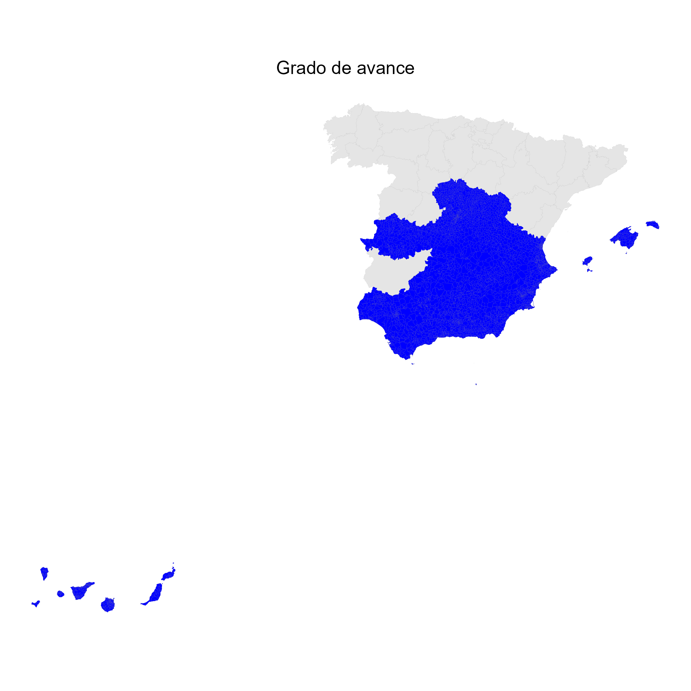

# Códigos postales de España

El producto final es `data/codigos_postales.gpkg`, con la capa
`codigos_postales`: una fila por código postal (CP) y sus superficies disueltas,
incluidas las que pertenecen a distintas provincias. Un código puede tener
varias superficies separadas. La capa postal no incluye el municipio;
los recintos sin asignar se conservan en la capa `pendientes`.

Son delimitaciones estimadas a partir de direcciones de CartoCiudad y recintos
administrativos, no límites postales oficiales. El consolidado cubre únicamente
las provincias generadas que estén presentes en `data/provs/`.

## Antecedentes

Disponer de polígonos de códigos postales permite relacionar direcciones y
estadísticas con áreas geográficas. Sin embargo, la consulta de un código
postal y la descarga de sus límites son servicios distintos.

Según [Goerlich (2022)](https://doi.org/10.12842/WPIVIE_0322),
hacia 2016 los polígonos de códigos postales de Correos se podían descargar
desde CartoCiudad a través del CNIG. Esa capa dejó de ofrecerse para descarga
a principios de 2017, tras un cambio en la política de datos de Correos.

Actualmente, [Correos comercializa la capa cartográfica](https://www.correos.es/es/es/empresas/marketing/identifica-a-tus-clientes-potenciales/base-de-datos-de-codigos-postales)
mediante una licencia de pago. CartoCiudad mantiene un
[WMS de códigos postales](https://www.cartociudad.es/web/portal/directorio-de-servicios/visualizacion)
para visualización, pero indica que esos polígonos no están disponibles para
descarga.

Este proyecto busca ofrecer una estimación reproducible a partir de las
direcciones abiertas de CartoCiudad y de límites administrativos. Cada
dirección aporta una posición y un código postal: una teselación de Voronoi
divide el espacio en áreas de proximidad a esas posiciones. Al recortarlas a
los recintos administrativos y unir las áreas con el mismo código se obtiene
una delimitación postal estimada. La proximidad es una aproximación geométrica
y no reproduce necesariamente las decisiones de reparto de Correos.

## Metodología

El proyecto se basa en
[«Elaboración de un mapa de códigos postales de España con recursos libres»,
de Francisco Goerlich](https://www.uv.es/goerlich/Ivie/CodPost.html), y en
[«Así hice el mapa de los códigos postales de España con SIG y datos abiertos»,
de José Ignacio Sánchez, en NoSoloSIG](https://www.nosolosig.com/articulos/asi-hice-el-mapa-de-los-codigos-postales-de-espana-con-sig-y-datos-abiertos).

La idea común es construir áreas de influencia de las direcciones de
CartoCiudad mediante una teselación de Voronoi, ajustarlas a los recintos
administrativos y disolverlas por código postal. De Goerlich se toma el
tratamiento independiente de cada componente del municipio y la asignación
directa del recinto cuando sus direcciones seleccionadas tienen un solo CP.

Esta implementación tiene decisiones propias: usa márgenes interiores de
200 y 50 m, frente a los 20 m descritos por Goerlich, y conserva sin asignar los
recintos sin direcciones seleccionadas, salvo que el municipio tenga un único
CP recuperado en sus otros componentes. No se completan por proximidad.
La salida se consolida por CP entre provincias. El procedimiento no garantiza
la coincidencia con los límites postales oficiales ni la inclusión de todos
los CP presentes en las direcciones originales, pues el filtrado por márgenes
puede excluirlos.

## Descarga del repositorio

Los GeoPackage publicados se almacenan con **Git LFS**. Instala
[**Git LFS**](https://git-lfs.com/) antes de clonar el repositorio y ejecuta
`git lfs install`. Si ya tienes una copia, ejecuta `git lfs pull` para descargar
los datos. Sin LFS puedes obtener archivos de referencia en lugar de los
GeoPackage completos. Las descargas de `data/cartociudad/` siguen ignoradas.

También puedes descargar directamente el
[GeoPackage completo](https://media.githubusercontent.com/media/dieghernan/codigospostales/main/data/codigos_postales.gpkg)
o la [versión simplificada](https://media.githubusercontent.com/media/dieghernan/codigospostales/main/data/codigos_postales_simplificado.gpkg),
sin clonar el repositorio. Los [ejemplos en **R** y **Python**](docs/_pages/ejemplos.md)
explican cómo leer solo los códigos que empiezan por un prefijo concreto.

## Generación

Desde la raíz del proyecto, con los paquetes **sf**, **dplyr**, **ggplot2**,
**mapSpain** y **readr** instalados:

```r
Sys.setenv(CP_PROVINCIA = "SEGOVIA")
source("scripts/cp_prov.R")
```

Las entradas se guardan en `data/cartociudad/`, ignorada por Git:
`LAU2boundaries4Spain.gpkg`, de
[Goerlich y Pérez Vázquez (2025)](https://zenodo.org/records/15345101), y el ZIP provincial de
CartoCiudad, por ejemplo `CARTOCIUDAD_CALLEJERO_SEGOVIA.zip`.
Del GeoPackage administrativo se utilizan las capas `Municipios2024`,
`Condominios` y `Provincias`.

El script procesa cada componente del recinto administrativo. Selecciona
direcciones dentro de un margen interior de 200 m, con un segundo intento de
50 m si no encuentra ninguna. Con un solo CP asigna el recinto completo; con
varios utiliza polígonos de Voronoi recortados al recinto. Si no encuentra
direcciones, deja el recinto sin CP.

Al terminar todos los componentes del municipio, si solo se ha recuperado un
CP distinto, ese código se asigna también a sus componentes pendientes. Si se
han recuperado varios CP o ninguno, los pendientes se conservan sin asignar.

Los cálculos usan el huso UTM del punto interior representativo de la provincia:
ETRS89 / UTM 29, 30 o 31 en la península y Baleares, y REGCAN95 / UTM 28 en
Canarias. Se utiliza `st_point_on_surface()` para que ese punto quede dentro
del recinto. Los recintos administrativos y el fondo provincial proceden del
mismo archivo de Goerlich y Pérez Vázquez.
La lectura SQL selecciona únicamente la provincia solicitada y los campos
necesarios, sin cargar todos los municipios de España en memoria.

Tras separar los componentes, los solapes administrativos se asignan al
recinto original de menor superficie. En un empate se conserva el primero en
el archivo de entrada. No se aplican tolerancias para cerrar huecos.

Cada ejecución guarda el resultado intermedio en `data/provs/CP_XX.gpkg` y
ejecuta `scripts/consolidado.R`. Este reúne todos los resultados provinciales,
los transforma a EPSG:25830 y disuelve las superficies por `COD_POSTAL`, sin
restringir los códigos por su prefijo postal. Así actualiza el producto
final `data/codigos_postales.gpkg`. Los registros sin CP quedan excluidos del
consolidado postal y se conservan con geometría en la capa `pendientes` del
mismo GeoPackage, con provincia de origen y área en metros cuadrados, medida
en la proyección del resultado provincial. Sus atributos se exportan a
`data/full_analisis/missing.csv`. Las nuevas ejecuciones provinciales también
guardan una capa `pendientes` antes de disolver por CP;
para resultados antiguos se recupera la geometría sin CP disponible.

Ambas capas del producto final contienen únicamente geometrías
`MULTIPOLYGON`. Los CP se conservan como texto de cinco dígitos, incluidos los
ceros iniciales. La ejecución provincial fija una configuración UTF-8 en
**Windows**. Estas mejoras se aplican al regenerar cada provincia; consolidar
resultados antiguos no repite su asignación postal ni resuelve sus solapes
administrativos de origen.

La consolidación elimina anillos interiores de hasta 1 mm² que no contienen
superficie de otro CP ni de un pendiente. Conserva los enclaves, los agujeros
mayores y todos los contornos exteriores; no simplifica ni desplaza vértices.
La detección usa el área del anillo con coordenadas trasladadas al origen para
evitar cancelaciones numéricas. Esta limpieza no asigna los recintos pendientes.

Para reconstruir únicamente el consolidado y el mapa, sin regenerar provincias:

```r
source("scripts/consolidado.R")
```

## Versión simplificada

Para generar una copia destinada a visualización, con **rmapshaper** instalado:

```r
source("scripts/simplificado.R")
```

Escribe `data/codigos_postales_simplificado.gpkg` con las mismas dos capas y
atributos. Simplifica ambas capas juntas con `keep = 0.2`,
`keep_shapes = TRUE` y `explode = TRUE`, y después vuelve
a agrupar por registro. Comprueba que se conservan todos los CP y pendientes,
sin geometrías vacías y con salida válida `MULTIPOLYGON`. Las reparaciones
pueden unir o separar componentes. No modifica el consolidado completo ni se
ejecuta automáticamente al generar provincias. El campo `AREA_M2` de los
pendientes conserva el área de la versión completa; la copia simplificada no
debe usarse para mediciones precisas. Los vértices protegidos por la topología
y la conservación de piezas pueden hacer que la proporción final supere el 20 %.

## Revisión de pendientes con WMS

La revisión se ejecuta solo a requerimiento, fuera de la generación habitual:

```r
source("scripts/pendientes_wms.R")
```

Requiere además **httr2** y **jsonlite**. Selecciona los 50 recintos pendientes
de mayor superficie, omitiendo los que quedaron sin asignar en revisiones
anteriores (identificados por provincia, municipio y superficie). Genera los
centros de una malla de 3 × 3 celdas sobre la caja de cada recinto y consulta
únicamente los puntos estrictamente interiores en la capa `codigo-postal` del
[WMS de CartoCiudad](https://www.cartociudad.es/web/portal/directorio-de-servicios/visualizacion).
Asigna el recinto completo solo si todos los puntos conservados tienen
respuesta y devuelven un único CP común. Los recintos sin puntos interiores,
con respuestas vacías o errores, o con varios CP se mantienen pendientes.

Cada revisión conserva sus coordenadas EPSG:25830, respuestas, fechas y
decisiones en una carpeta `data/full_analisis/wms_FECHA_HORA/`. Las asignaciones
se incorporan a los resultados provinciales y después se reconstruye el
consolidado. Regenerar una provincia desde las direcciones sustituye estas
correcciones y requiere una nueva revisión. El muestreo no garantiza que no
existan otros CP entre los puntos consultados o en componentes no muestreados.

## Grado de avance



## Sitio web y visor

La web del proyecto se encuentra en `docs/` y utiliza **Jekyll** con **Chulapa** y la
skin **Focal**. Para previsualizarla con **Ruby** y **Bundler** instalados:

```sh
cd docs
bundle install
bundle exec jekyll serve
```

Abre `http://localhost:4000/codigospostales/`. Para compilar sin iniciar un
servidor, ejecuta `bundle exec jekyll build` desde `docs/`.

El visor utiliza **Leaflet** y **Leaflet-providersESP**, con IGNBase Gris, IGNBase y PNOA como fondos
alternativos y capas activables de CartoCiudad y de las delimitaciones
estimadas. Inicialmente muestra IGNBase Gris con ambas capas activadas; el control
de capas está plegado y el zoom con la rueda está habilitado. La vista inicial
muestra el prefijo postal `08`. Carga los
códigos por sus dos primeros dígitos, conservando los ceros iniciales. Este
filtro selecciona códigos completos y no recorta las geometrías a una
provincia. Prefijo postal y provincia son criterios distintos: un mismo código
postal puede abarcar varias provincias. Para seleccionar datos por provincia
se necesita un criterio espacial sobre sus límites administrativos.
El WMS de CartoCiudad se muestra a partir del zoom 11.
El overlay de límites administrativos del IGN está desactivado inicialmente
y se puede activar desde el control de capas para comparar ambos criterios.

El mapa se integra mediante un `iframe`. La
[vista a toda ventana](https://dieghernan.github.io/codigospostales/visor/mapa/)
conserva el selector de prefijos, los controles de capas y las atribuciones,
y se puede incrustar en otras páginas.

Después de actualizar la versión simplificada, regenera los datos del visor
desde la raíz del repositorio, con **sf** y **jsonlite** instalados:

```r
source("scripts/visor_datos.R")
```

Este script exporta los códigos a `docs/assets/data/`, en GeoJSON WGS84
(EPSG:4326) por prefijo, con seis decimales, sin modificar el GeoPackage.
El visor no incluye los recintos pendientes. La imagen estática se regenera con
`source("scripts/ejemplo_prefijo.R")`.
El ejemplo equivalente de **Python** se ejecuta con
`python scripts/ejemplo_prefijo.py`, tras instalar las dependencias de
`scripts/requirements-ejemplos.txt`. Los scripts guardan sus mapas en
`docs/assets/img/`, con las fuentes y la autoría incluidas. El código y las
versiones comprobadas se describen en los [ejemplos](docs/_pages/ejemplos.md).

El flujo `.github/workflows/build-chulapa-gh-pages.yml` compila la web una vez
y utiliza el mismo artefacto para desplegar en GitHub Pages y actualizar la
rama `gh-pages`. Antes del primer despliegue hay que seleccionar **GitHub
Actions** como origen en la configuración de Pages del repositorio.

### Metadatos y comprobación de la web

Después de actualizar los consolidados, ejecuta `py scripts/product_metadata.py`
(o `python3 scripts/product_metadata.py` en **Linux**) para actualizar tamaños,
fechas y cifras de la ficha de producto y las huellas SHA-256 de los archivos.
La fecha se lee del GeoPackage y no
representa la antigüedad de las fuentes. El script no modifica los datos.

La web utiliza `assets/css/custom.scss`, el mecanismo de estilos propios de
**Chulapa**, y `header_type: base` para una cabecera compacta. El visor conserva
su estilo y permite buscar un CP completo y compartir prefijo, posición, zoom
y CP seleccionado sin incluir direcciones buscadas.

Tras compilar desde `docs/`, ejecuta desde la raíz:

```sh
py scripts/check_site.py
py -m unittest discover -s tests -p test_site_checks.py
npm ci --prefix tests/site
cd tests/site
npx playwright install chromium
npm test
```

En **Linux**, usa `python3` en lugar de `py`. Las comprobaciones revisan enlaces
internos y sus anclas, metadatos y recursos del visor. Las pruebas de navegador
comprueban la carga de áreas, la búsqueda de CP, la recuperación de una vista,
los errores de descarga y el diseño móvil. Requieren acceso a las CDN de
**Leaflet** y **Leaflet-providersESP**. El workflow las ejecuta antes de publicar.

Para previsualizar el artefacto compilado, ejecuta `node tests/site/serve.cjs`
y abre `http://127.0.0.1:4173/codigospostales/`. Detén este servidor antes de
`npm test`, que inicia su propia instancia. El servidor de previsualización
adapta las URL absolutas del proyecto para usar los recursos locales.

## Uso de inteligencia artificial

Se ha utilizado **OpenAI Codex** como apoyo en el desarrollo del código,
la redacción y revisión de la documentación y la preparación del sitio web.
Los banners del proyecto se generan con geometrías reales mediante
`scripts/focal_banners.py`, con Fira Sans y la paleta de **Focal**. Estas
herramientas no son la fuente de los datos geográficos: se utilizan las
direcciones de CartoCiudad y los límites administrativos de Goerlich y
Pérez Vázquez, referenciados en este documento.
